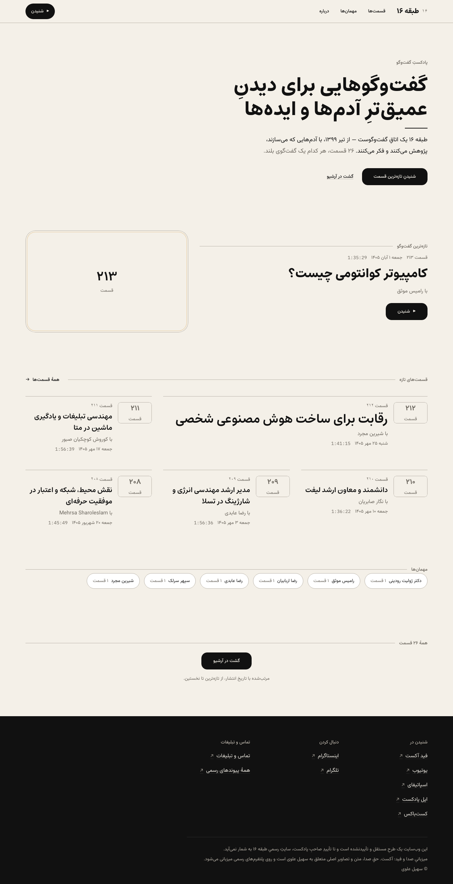
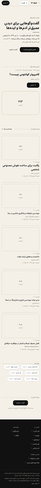
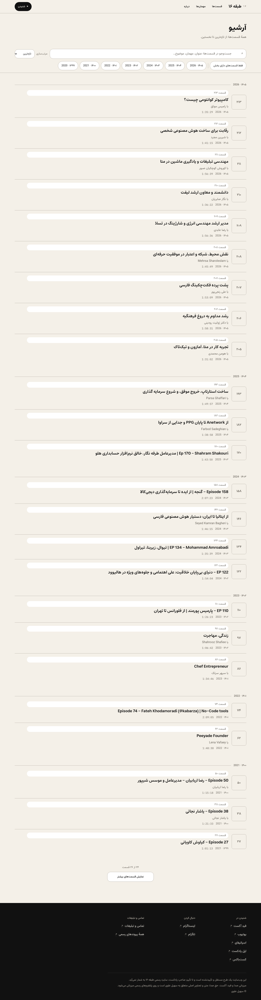
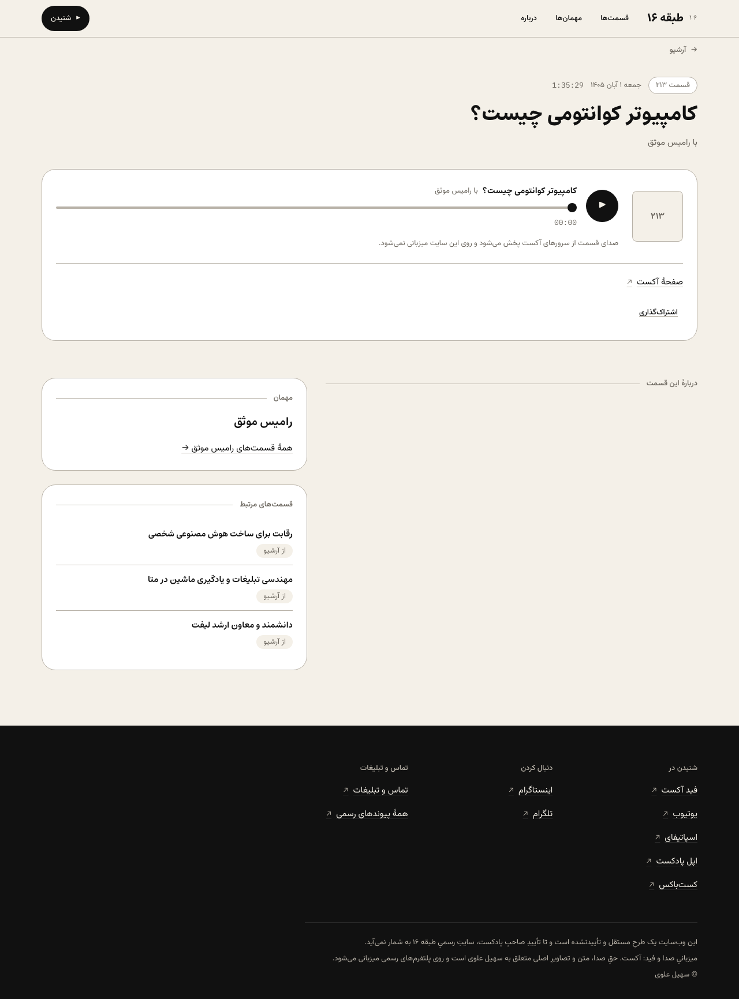
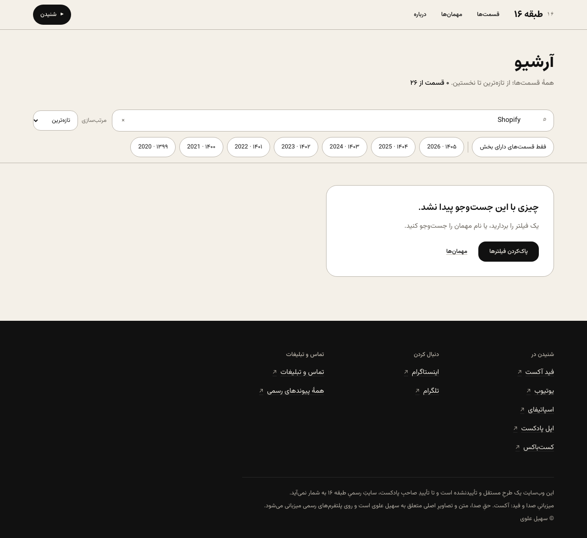
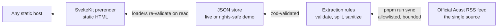

# Tabaghe 16 — Independent Website Concept

**طبقه ۱۶** — a Persian-first, right-to-left editorial archive for the [Tabaghe 16](https://shows.acast.com/tabaghe16) podcast: one place to search every episode, follow a guest across the years, jump to a chapter, and continue listening on the official platform of choice.

> **Status — read this first.** This is an **independent, unsolicited concept**. It is not the official Tabaghe 16 website and has no affiliation with, endorsement from, or authorization by the show or its owner. The committed dataset is a rights-safe demo — real titles, dates, durations, and official outbound links only; the full archive syncs from the official feed at runtime. Public visibility is for review and evaluation only — see [Rights and non-affiliation](#rights-and-non-affiliation).

## The problem

Six years of long-form conversations live on Acast, Apple Podcasts, Spotify, Castbox, and YouTube — and the show's official link hub routes listeners to all of them well. But a link directory cannot answer the archive's own question: _which episode was that conversation about X, with Y?_ Finding it today means scrolling platform apps and hoping the memory of a title holds.

## The solution

One complementary, first-party archive — **not** a replacement for any platform, and never a re-host of the show's audio. Every episode gets a stable, crawlable page with its verified metadata; search, year and chapter filters, and sort work over normalized Persian/Latin text; guests connect to every conversation they appeared in; the source's own chapter list seeks the player to the right minute; and every listen path leads to the official destination.

## Visual tour

Every image below is a **real capture of this exact code running in its rights-safe demo mode** (desktop 1280×900, mobile 390×844). The number-plate frames in place of artwork are the project's own designed placeholders — the demo mode ships no source artwork, descriptions, or chapter text.

|                                                                                                                                                                               |                                                                                                                                                |
| ----------------------------------------------------------------------------------------------------------------------------------------------------------------------------- | ---------------------------------------------------------------------------------------------------------------------------------------------- |
|  |  |
| _Home — the featured conversation leads; the recent grid and archive link follow_                                                                                             | _Home at phone width — the same composition, recomposed for one hand_                                                                          |



_The archive — search-first, grouped by publication year, with filters that combine and clear._

|                                                                                                                               |                                                                                                             |
| ----------------------------------------------------------------------------------------------------------------------------- | ----------------------------------------------------------------------------------------------------------- |
|  |  |
| _Episode page — the player, the source's own chapters, the guest, related episodes_                                           | _Search in action — Persian and Latin queries, shareable by URL_                                            |

## What's implemented

Everything below exists in this code and is exercised by its test suites.

- **Persian-first RTL** — Jalali dates with machine Gregorian values alongside, Persian digits in editorial data and Latin digits in the mono data voice, bidi isolation for mixed-script text, ZWNJ preserved from the source, a mobile drawer with full focus management (focus moved in, trapped, returned on close).
- **Editorial home** — a featured conversation band in full color over the monochrome print treatment, an asymmetric recent grid with a lead card, typographic guest chips, and a designed fallback plate that keeps every media frame whole when the source image host is slow or unreachable.
- **Archive** — client-side search over normalized text (Arabic/Persian character and digit folding, ZWNJ), year and has-chapters filters, newest/oldest sort, load-more, a recovery empty state, and shareable `?q=…&year=…&sort=…&chapters=1` URLs.
- **Episode pages** — a real player over the verified enclosure (play/pause, seek, clock, buffering and failure states with platform fallbacks), the source's own chapter list (each row seeks playback; the first press fetches only the media metadata), the guest, the sponsor block rendered verbatim in its own treatment, and related episodes with their stated reasons.
- **Guest routes** — typographic guest pages listing each confirmed guest's episodes. Topic routes ship ready-but-empty: the feed carries no categories, and inventing a taxonomy is out of scope.
- **The signature press** — a fabric-wave interaction on primary actions and play controls: the surface responds at the pointer's contact point, a restrained wave travels and settles, keyboard activation uses the center origin, and `prefers-reduced-motion` replaces the whole effect with a simple color change.
- **Accessibility, verified not declared** — the E2E suite runs an axe audit (WCAG 2.x AA tags) over every public route in both mobile and desktop projects, asserting zero serious or critical violations; keyboard operation and reduced-motion are covered by dedicated tests. A full screen-reader session has not been performed.

## How it works

A statically prerendered SvelteKit 3 + Svelte 5 site (strict TypeScript, pnpm, Vite). `pnpm run sync` fetches the official Acast RSS feed — the single allowlisted source, bounded by timeout and size caps — and runs every item through validated extraction rules (title/guest confirmation from the episode's own bio text, chapter parsing across the feed's five separator styles, sponsor validation, a narrow sanitization allowlist) into a zod-checked JSON store. Every page is prerendered from that store; there is no server, no database, and no client-side API.



**The demo dataset** (`data/demo-store/`) is the committed default: 26 minimal records — real titles, dates, durations, official page and enclosure links, guest names — with no descriptions, chapters, sponsor blocks, or artwork, so nothing in this repository redistributes the feed's editorial content. Running `pnpm run sync` creates the live store (git-ignored here) and the site serves the full archive, loading artwork from the provider at runtime. Full details: [Architecture](docs/ARCHITECTURE.md) · [Data provenance](docs/CONTENT_SOURCES.md) · [Deployment](docs/DEPLOYMENT.md).

## Run it locally

Requires Node.js ≥ 22.17 and pnpm.

```sh
pnpm install       # from a clean clone
pnpm run dev       # demo mode at http://localhost:5173 — no other setup
pnpm run sync      # optional: fetch the official feed and serve the live archive
```

| Command                               | Purpose                                                                                                       |
| ------------------------------------- | ------------------------------------------------------------------------------------------------------------- |
| `pnpm run build` / `pnpm run preview` | Production build, then serve it at :4173                                                                      |
| `pnpm run check` · `pnpm run lint`    | Type-check (tests included) · ESLint + Prettier                                                               |
| `pnpm test`                           | Unit suite (Vitest)                                                                                           |
| `npx playwright test`                 | E2E suite against the production build (auto-builds and serves it; all third-party requests blocked per-test) |

## Limitations

- No official endorsement, and no permission to use the show's name, marks, artwork, or content beyond the factual metadata and outbound links in the demo dataset.
- Not production-ready for official operation: no admin panel (refreshing content is `pnpm run sync` + a commit), playback stops on route changes, and the curated topic list is empty by design.
- The demo's 26 records exercise the product; they are not the archive, and the captures above show demo data.
- Accessibility rests on the axe audit and a manual keyboard pass; a dedicated screen-reader session has not been performed.

## Rights and non-affiliation

- **This is not open source.** The [`LICENSE`](LICENSE) notice grants review and evaluation only — no right to copy, modify, redistribute, or commercially exploit this project without written permission. Third-party materials (fonts under SIL OFL 1.1, notices in [`licenses/`](licenses); the show's name, marks, episode content, and artwork) remain the property of their respective owners.
- **Non-affiliation:** an independent concept. Until the podcast's owner approves it, it must not be presented as official, and nothing here may imply endorsement.
- **Security:** see [`docs/SECURITY.md`](docs/SECURITY.md) for the implemented controls and how to report an issue.

---

_Concept design and implementation: Maverick Limitless. Data: the official Acast feed for Tabaghe 16. Fonts: Vazirmatn, Estedad, IBM Plex Mono (SIL OFL 1.1)._
