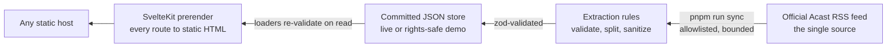

# Architecture — Tabaghe 16 website concept

How the Tabaghe 16 concept is built: a fully static, Persian-first SvelteKit site whose content comes from the official Acast RSS feed, synced into a committed JSON store at build time.

- **Document type:** engineering blueprint for the independent Tabaghe 16 website concept — not an official website.
- **Status:** companion to `docs/CONTENT_SOURCES.md` (verified data sources) and `docs/DEPLOYMENT.md` (operating the static build).

## The shape of the system

A Persian-first, right-to-left **statically prerendered SvelteKit site**: a CLI sync fetches the official Acast RSS feed, extracts and validates episode data into JSON stores, and every public page is server-rendered (prerendered) from those stores at build time. There is **no runtime server, no database, no admin panel**: content changes only through `pnpm run sync` + a git commit, so prerendered HTML is server-rendered HTML for crawlers, and a static host serves the result.

## Routes

| Route | Purpose |
| --- | --- |
| `/` | Editorial home: featured conversation, recent grid, guest chips, archive call-to-action |
| `/episodes` | Search-first archive: normalized Persian/Latin search, year and has-chapters filters, sort, load-more, shareable query URLs |
| `/episodes/[slug]` | Episode page: player, source chapters, guest, sponsor block, related episodes |
| `/people`, `/people/[slug]` | Guest directory and per-guest episode lists (typographic — the feed carries no portraits) |
| `/topics`, `/topics/[slug]` | Curated topic routes; render only when `data/topics.json` is curated (ships empty by design) |
| `/about`, `/partnerships`, `/privacy` | Written pages; facts only, no invented metrics |
| `404` fallback | The Persian recovery page for any unmatched URL |

## The store: two directories, one loader

`src/lib/server/store.ts` is the single module that reads the JSON stores, re-validates them with zod on every read (a hand-corrupted file fails the build instead of rendering nonsense), merges editorial overrides, and derives the view models. Loaders never touch the network.

Two store directories exist:

- **`data/store/` — live.** Written by `pnpm run sync` from the official feed. Contains the full archive: 200+ episodes with descriptions, chapters, sponsor blocks, and artwork URLs (loaded from the provider at runtime; never downloaded into the repository). Git-ignored in the public checkout.
- **`data/demo-store/` — the committed rights-safe default.** A small deterministic dataset (26 episodes across all six years) carrying real titles, dates, durations, official outbound links, and guest names — with **no** descriptions, chapter text, sponsor copy, or artwork URLs. The project's own number-plate placeholders carry every media frame. Generated by `scripts/make-demo-store.ts`, which derives it from a synced live store.

The loader resolves live-first, demo-fallback: a clean checkout runs in demo mode; running `pnpm run sync` creates the live store and the site serves the full archive. Two files are **editor-curated and shared by both modes**: `data/topics.json` (the curated topic list) and `data/overrides.json` (featured/hidden flags) — sync never writes them, so a curator's file applies in demo and live mode alike and a feed refresh can never erase a curated value.

## Episode schema (the contract)

Each episode record is validated by `zod` (`src/lib/server/schema.ts`). Every field is copied from the feed, derived by a documented rule, or `null` — a field is never invented to fill a gap. Key fields:

| Field | Source / rule |
| --- | --- |
| `guid`, `slug` | Feed GUID; slug from the feed's own `acast:episodeUrl` when URL-safe (the feed's page slugs don't match its episode numbers, so numbering is never an address) |
| `episodeNo` | `itunes:episode` when present; null otherwise — a display label only, never a sort key |
| `titleSource`, `titleHeadline`, `titleByline`, `roleText` | The raw title; the pipe-split headline, guest, and role when the extraction rules confirm them |
| `publishedAt` | `pubDate`, normalized to ISO-8601 UTC — the only honest ordering key |
| `durationSeconds` | `itunes:duration` in any of the three shapes the feed uses |
| `audioUrl` | The enclosure, validated by host and path shape — sync never fetches media to check it |
| `imageUrl` | `itunes:image` on the allowlisted artwork host |
| `acastPageUrl`, `videoUrl` | Item links on the allowlisted hosts; video only when the feed itself carries the YouTube link |
| `chapters` | Validated `{timeRaw, timeSeconds, label}` rows parsed from the description's own timestamped lines; null below a minimum count |
| `sponsor` | `{heading, entries[{text, url}]}` only when a source-heading form is matched, the blurb parses, and the URL is allowlisted |
| `descriptionHtml` | The source description, sanitized to a narrow tag allowlist with the extracted areas removed |
| `guestSlugs` | Confirmed guests only — a name becomes a person record solely when the episode's own bio text anchors it |

## Sync and extraction

`scripts/sync.ts` fetches the single allowlisted feed with a timeout and response-size cap, then runs every item through the extraction pipeline (`src/lib/server/extract/`):

1. **Parse safely.** `fast-xml-parser` with entity resolution disabled — internal entities stay literal and external entities throw, so XXE and entity-expansion are removed as failure classes, not mitigated. Pinned by `tests/unit/feed-parser.test.ts`.
2. **Extract.** Title/guest confirmation from the episode's own bio anchors; chapter lines from the description's five attested separator styles; the sponsor area terminated by the show's own link-hub line (the hub is on the never-allow list); the Acast footer separated from prose.
3. **Sanitize.** `sanitize-html` with a narrow allowlist (`p, br, a, strong, em, b, i, ul, ol, li, blockquote`), `https:`/`mailto:` hrefs only, strip-never-blank for unsafe schemes, and `rel="noopener noreferrer"` forced onto every surviving link.
4. **Upsert idempotently.** Matched by GUID; a re-run changes nothing but `lastSeenAt` (proven by `changedFields` in the unit suite). Slugs and guest identity are stable across runs; episodes missing from a truncated feed are retained.
5. **Record.** `data/store/sync-run.json` stores the run's timing, status, and counts; failures leave the previous store serving and are recorded with sanitized messages (no stack traces, no secret-bearing URLs).

## The listening experience

The episode page's audio element is created with `preload="none"` and consumes the episode's verified enclosure URL directly — per playback request, inside the visitor's browser. The browser resolves Acast's per-request redirect chain itself; no media URL is ever cached or proxied through this site, and the CSP `media-src` allowlist covers both Acast hosts. Chapter rows are operable before playback begins: the first press requests only the media metadata, and the seek lands only once the stamp is inside the real duration. Playback failure shows the designed error state with the real platform fallback links.

## Security boundaries

- **No server, no accounts, no visitor data.** Nothing is collected, so there is nothing to leak; there is no admin surface to protect in this cut.
- **Feed ingestion** is bounded (timeout, size cap, allowlisted host) and accepts no URL from any request — the feed URL is a constant; `--input <file>` serves offline/test runs.
- **Rendering** only ever shows sanitized description HTML; all other values are escaped at the template boundary by Svelte.
- **CSP** is generated by SvelteKit in hash mode (`vite.config.ts`): strict `script-src 'self'` plus the framework's own inline-bootstrap hashes, allowlisted `img-src`/`media-src` for the two verified Acast hosts, `frame-src 'none'`, `object-src 'none'`. No `on*` event-handler attribute exists in any built page.
- **Dependencies** ship no analytics, no third-party scripts, and no fonts beyond the self-hosted OFL families (bundled from the `@fontsource` packages). Hosts must add the transport headers a meta-tag CSP cannot carry (HSTS, `frame-ancestors`, `X-Content-Type-Options`, `Referrer-Policy`) — the contract is in `docs/DEPLOYMENT.md`.

## Testing strategy

Unit tests (`tests/unit/`, Vitest) pin the pipeline's rules against a sanitized feed fixture: parser safety proofs, slug and collision rules, chapter parsing across every separator style, the sanitizer's allowlist and scheme policy, sponsor extraction, title assembly, and the idempotency seam. End-to-end tests (`tests/e2e/`, Playwright, mobile + desktop projects) run against the production build with a local silent-audio fixture served from the enclosure's URL — playback, seeking, the drawer's focus contract, the fabric-wave press phases, reduced-motion suppression, the axe accessibility audit over every public route, and the 404 recovery page. All external requests are blocked per-test; the suite never reaches a third-party service. Assertions derive their targets from the active store (`tests/e2e/active-store.ts`), so they hold identically in a synced checkout and a clean checkout's demo mode.

## Maintenance-relevant decisions

- **Prerendered-static, not a running server.** All data changes through sync + commit; request-time rendering buys nothing, and rollback is `git revert`. The store (215 episodes ≈ 1–2 MB JSON) is trivially held in git with visible diffs per sync.
- **No admin panel.** A concept build with no deployment destination has no secure credential story; `pnpm run sync` + commit is the entire content workflow. The archive's stale-data banner is the only public freshness surface — it appears when the last successful sync is older than a configured threshold.
- **Topics ship empty.** The feed carries no per-item categories, so a topic taxonomy would be invented; the routes and the curated file exist, and they activate when a human curates them.
- **Guests are typographic.** No portraits exist in any verified source, so guest pages present names and episode lists only. A name becomes a person record only when the episode's own bio text confirms it — conservative by design, since inventing a guest is worse than showing none.
